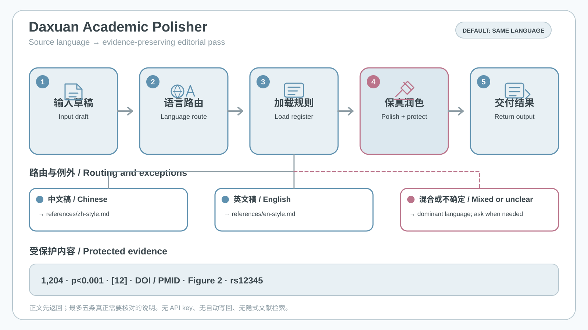

# Daxuan Academic Polisher



Daxuan Academic Polisher edits existing Chinese or English academic prose in its dominant source language while preserving facts, numbers, units, citations, identifiers, claim strength, terminology, voice, and paragraph structure. Explicit output-language requests override routing.

## Install

```bash
npx skills add DaXuanGarden/daxuan-academic-polisher --skill daxuan-academic-polisher --agent codex --global --copy --yes
```

Then say:

```text
Use $daxuan-academic-polisher to polish this English Results paragraph. Preserve every number, p-value, unit, citation, and paragraph break; add no results.
```

The workflow diagram is a static contract visualization, not a model run. Run `python3 scripts/build_showcase.py` to regenerate it. See the [Chinese README](README.md), [examples](examples/README.md), and [polishing report](reports/polish-report.md) for routing, checks, fixtures, and boundaries.

[MIT](LICENSE) · Copyright (c) 2026 Daxuan
