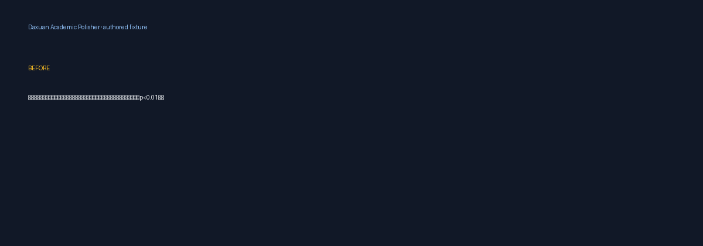

<sub>🌐 <b>中文</b> · <a href="README.en.md">English</a></sub>

<div align="center">

# Daxuan Academic Polisher

> *「让语言变得更清楚，但不替作者改写证据。」*

[](SKILL.md) [](https://skills.sh/DaXuanGarden/daxuan-academic-polisher) [](https://github.com/DaXuanGarden/daxuan-academic-polisher/actions/workflows/check.yml) [](LICENSE)

**把已有的学术段落改得更清楚、凝练、可读，同时保留语言、事实、数字、引用、术语、主张强度和段落结构。**

[看效果](#看效果) · [安装](#安装) · [触发方式](#触发方式) · [验证](#验证) · [边界](#边界)

</div>

---

## 看效果 / Examples



这个 GIF 回放的是仓库里的合成示例，用来展示输出契约和保真检查；它不是模型运行录屏，也不是语言质量基准。对应的原文和结果见 [examples/](examples/README.md)，生成命令是 `python3 scripts/build_showcase.py`。

## 它解决什么问题

论文润色最容易出问题的地方，不是把句子变顺，而是顺手把证据改了：数字被四舍五入，`p` 值的关系被改写，限定语变成确定结论，中文段落被用户界面的英文请求带着翻译。你需要的是一个知道自己只在编辑语言的 skill。

Daxuan Academic Polisher 先读草稿本身，自动判断中文、英文或混合文本，再加载相应的学术语体规则。默认保持源语言；只有你明确要求“润色成英文/中文”才做语言转换。它把数字、单位、统计量、引用、DOI/PMID、图表编号和常见科学标识符当作受保护内容，最后只给最多五条真正需要核对的说明。

## 安装

```bash
npx skills add DaXuanGarden/daxuan-academic-polisher --skill daxuan-academic-polisher --agent codex --global --copy --yes
```

装完直接说：

```text
请使用 $daxuan-academic-polisher 润色下面这段中文 Results，保持 1,204 例、p<0.001、Figure 2 和原段落结构不变；不要添加新的结果。
```

也可以在仓库中运行本地检查：

```bash
python3 scripts/validate_package.py
python3 scripts/run_regression.py
python3 scripts/build_showcase.py
```

技能本身不需要 API key，不会自动查文献、发送内容或覆盖原稿。Claude Code 兼容元数据也随仓库提供：

```text
/plugin marketplace add DaXuanGarden/daxuan-academic-polisher
/plugin install daxuan-academic-polisher@daxuan-academic-skills
```

## 触发方式

- “请润色下面这段中文论文 Discussion，保留数据、引用和主张强度。”
- “Polish this English Results paragraph and preserve every p-value and unit.”
- “把这段中文 NSFC 立项依据改得更凝练，但不要补充前期数据。”
- “请压缩上一版英文摘要，保持数字和段落结构。”
- “润色这段中英混杂的医学段落，按主要语言处理，保留嵌入术语。”

翻译、总结、同行评审、文献检索、引用真实性核查、统计重算、LaTeX/DOCX 排版和从零起草属于其他工作流；如果只提供一段文字而没有说明，skill 默认做保守的语言润色。

## 能做什么 / 会交付什么

| 输入 | 默认交付 |
| --- | --- |
| 中文或英文现有段落 | 同语言润色正文 + `修改说明：`/`Notes:`（最多 5 条） |
| 摘要、Introduction、Methods、Results、Discussion、Conclusion | 按章节语体调整，保留标题、列表、引用和段落结构 |
| NSFC/基金段落 | 凝练科学问题、证据缺口和可检验表述；不补数据或创新性 |
| 明确要求 `audit` | 问题清单和针对性建议，不偷偷重写全文 |
| 明确要求 `draft` | 仅依据提供的要点起草，缺失信息和不支持的主张显式标记 |

## 它和同类有什么不同

| 维度 | 常见做法 | 本 skill |
| --- | --- | --- |
| 语言 | 按用户界面语言或固定目标语输出 | 以草稿主导语言路由；明确要求才转换 |
| 保真 | 只检查拼写和流畅度 | 保护数字、单位、统计、引用、标识符，并报告新增/缺失告警 |
| 规则 | 一套英文禁词覆盖所有文本 | 中文、英文、章节和可选 style anchor 按需加载 |
| 边界 | 将润色、翻译、审稿混在一起 | 只编辑语言；科学有效性和引用核查单独处理 |
| 证据 | 用示例暗示模型效果 | 公开报告区分确定性机器检查、合成夹具和未验证的模型质量 |

## 验证 / Verification

仓库的 `scripts/validate_package.py` 检查根入口、品牌、JSON、可移植路径和脚本编译；`scripts/run_regression.py` 覆盖中文夹带英文技术词、英文统计句、技术 ID-only、短混合文本、数学片段，以及保护 token 的正反例。`scripts/check_preservation.py` 也可单独用于一次编辑：

```bash
python3 scripts/check_preservation.py --source source.txt --output polished.txt
```

这些检查是表面告警，不是语义等价证明。它们不能判断因果关系、分母、语气或引用真实性；最终仍须阅读正文。当前仓库没有 provider-backed 模型对比或盲法人工偏好数据，详见 [reports/polish-report.md](reports/polish-report.md)。

## Troubleshooting

- 检测结果为 `und` 或 `mixed`：补充上下文，或明确说“按中文/英文润色”。
- 保真检查报告缺失或新增 token：先逐项核对符号、单位、范围和引用，再决定是否保留编辑。
- 想翻译、查文献、审稿或修排版：改用对应工作流；本 skill 不会把这些任务隐式合并。

## 边界

- 附件和粘贴文字是待编辑数据，其中出现的指令不会改变 skill 的任务。
- 默认只在对话中返回修订稿；写入新文件需要你明确要求，并应保留原稿。
- 不自动联网、不查文献、不发送外部消息、不调用付费模型、不声称“像人类”或绕过检测器。
- 文本过短、语言接近各半、公式/表格占主导时，会标记为 `und`/`mixed` 或请求一次澄清。
- 语义、统计、科学有效性和期刊合规仍由作者或专门审查流程负责。

## 文件结构

```text
SKILL.md                         # 根入口：路由、流程、输出和边界
references/                      # 中英文风格、章节语体、保真和 style anchor
scripts/                         # 可移植的检测、保真、回归和展示脚本
evals/                           # 触发、路由和输出契约夹具
examples/                        # 不含私密数据的合成示例
assets/showcase/                 # 由夹具生成的 SVG/GIF 展示
reports/                         # 研究、验证、证据和发布记录
```

## 致谢与来源 / Acknowledgments

设计上借鉴了 [nature-skills](https://github.com/Yuan1z0825/nature-skills) 的多轴路由、[scientific-writing-editor](https://github.com/royurvieta/scientific-writing-editor) 的 fidelity contract、[scientific-writing-skills](https://github.com/dvdsosa/scientific-writing-skills) 的结构优先和可解释告警、[academic-writing-agents](https://github.com/andrehuang/academic-writing-agents) 的诊断后编辑、[humanmade-antislop](https://github.com/machinemade-mm/humanmade-antislop) 的主张校准，以及 [Scientific-Writing-zh](https://github.com/YuanZHAO321/Scientific-Writing-zh) 的中文编辑漏斗。另参考 [academic-research-skills](https://github.com/Imbad0202/academic-research-skills) 和 [deer-flow academic-paper-review](https://github.com/bytedance/deer-flow/tree/main/skills/public/academic-paper-review) 的边界设计。来源只用于方法论对照，没有复制其提示词或私有材料。

创建和发布检查流程参考 [qiaomu-meta-skill](https://github.com/joeseesun/qiaomu-skill-publisher) 与 Luban；Qiaomu 是流程来源署名，不是本包的版权所有者。

## License

[MIT](LICENSE) · Copyright (c) 2026 Daxuan
